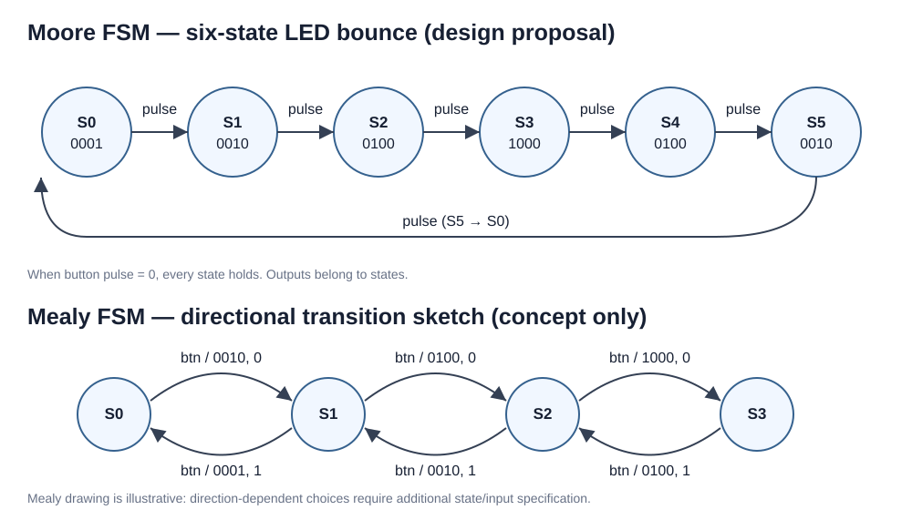

# FPGA Button Debounce & LED Control — Moore / Mealy FSM Study

**Verilog HDL · Digilent Basys3 · Vivado 2021.2**

This portfolio documents button-debounce and D flip-flop LED-control experiments, together with Moore and Mealy FSM state-diagram studies.

> **Scope:** The original RTL under `rtl/` implements a button-driven LED toggle, **not** the six-state LED bouncing pattern depicted in the Moore FSM diagram. The FSM diagrams are design studies; no multi-state RTL implementation or board test is claimed.

## Design overview

```text
btnU / btnD ──> selector ──> btn_debounce ──> clean_btn ──> led_toggle ──> LED
                 ^                  ^                             ^
                sel            tick_generator                  reset
                                    ^
                                100 MHz clk
```

The existing `top_btn.v` module selects one of two buttons and drives `btn_debounce`, `led_toggle` and the display LEDs. The `tick_generator.v` supplies a slow square wave. The debounce logic samples the selected button and updates `clean_btn` after a stable interval. The LED toggle register changes on the rising edge of `clean_btn`.

## FSM design diagrams



### Moore FSM

A Moore machine's output depends on the **registered state** only: `output = f(state)`. For a four-LED bounce pattern, the proposed six-state transition cycle is:

| State | LEDs [3:0] | Next state (button pulse) |
|---|---|---|
| S0 | 0001 | S1 |
| S1 | 0010 | S2 |
| S2 | 0100 | S3 |
| S3 | 1000 | S4 |
| S4 | 0100 | S5 |
| S5 | 0010 | S0 |

If no button pulse occurs, each state holds. A synchronous implementation should use the 100 MHz clock and a single-cycle, debounced button-enable pulse.


## video

[▶ Watch LED Button Control Demo](LED_btn_melay_demo.mp4)

### Mealy FSM

A Mealy machine's output depends on **state and input**: `output = f(state, input)`. Outputs are annotated on transitions as `input / output`, rather than inside state circles. The directional example in the figure is conceptual: if the same state has multiple transitions for the same button input, an additional direction signal or states are required to eliminate ambiguity. The sketched transitions are not a complete functional implementation.

## Repository structure

```text
rtl/
  btn_debounce.v    # Button stability counter
  led_toggle.v      # D flip-flop toggle on clean button edge
  tick_generator.v  # Slower clock / timer logic
  top_btn.v         # Top-level integration
constraints/
  Basys3_top_btn.xdc
docs/
  fsm_state_diagrams.svg
README.md
```

## Engineering notes and limitations

- **Clock-domain practice:** the existing RTL uses a derived clock for debounce and `clean_btn` as a clock for the LED register. A production-quality FPGA implementation should instead use a single system clock with clock-enable pulses and proper button input synchronization.
- **Button bounce:** the original small debounce counter was retained as a learning artifact. Its effective debounce duration depends on the sampling clock.
- **FSM distinction:** the RTL's flip-flop LED toggle is sequential logic, but is not itself a verified implementation of the displayed Moore/Mealy state diagrams.
- **Verification:** no completed functional simulation or hardware validation is claimed by this README. Add reproducible testbench files, waveforms, and board demonstration when available.

## Next development steps

1. Build dedicated Moore and Mealy RTL modules and testbenches.
2. Add a 2-flip-flop synchronizer and generate a one-clock-cycle button pulse.
3. Simulate state transitions, reset behavior and button bounce.
4. Record a Basys3 LED demonstration and attach it under `media/` or link externally.

## Tools

- Digilent Basys3 FPGA development board
- AMD/Xilinx Vivado 2021.2
- Verilog HDL
